<div align="center">






## 🕹️ Pick a room

<div align="center">





### 💬 Want to build something? Medical AI · Youth Policy · Research · Internships

[](https://www.linkedin.com/in/prakharbiswas/)
[](https://github.com/prakharbiswas)

```text
सहानुभूति + इंजीनियरिंग = एक बेहतर इंसानी दुनिया
```

</div>
