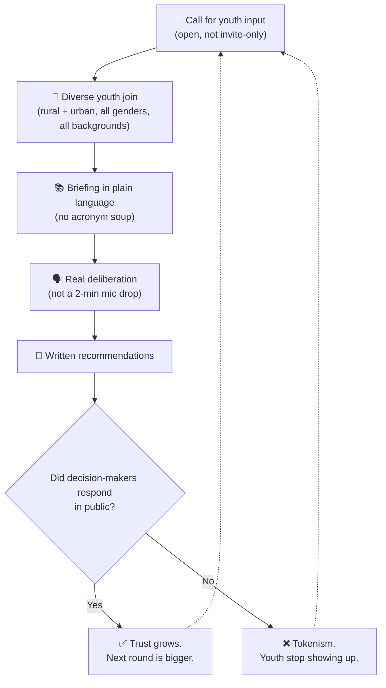
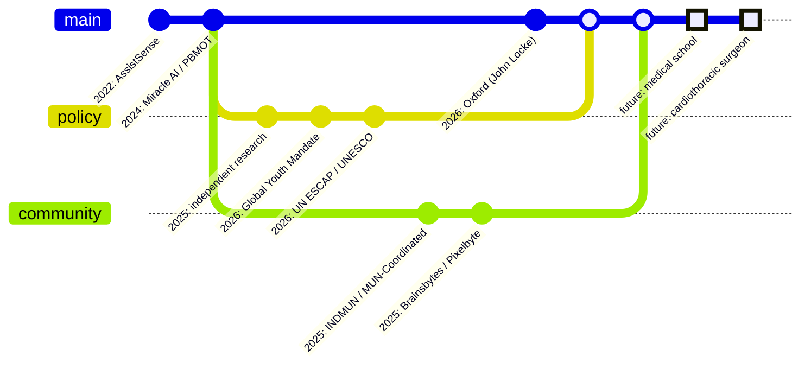
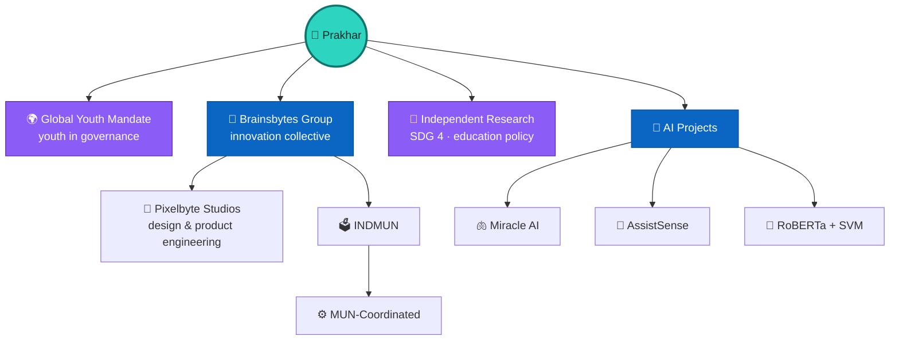

<a name="top"></a>
<div align="center">


# `PRAKHAR.EXE`

### v2026.11 · a README you can *play*

**Medicine · AI · Policy · Bad puns · Good intentions**


</div>

---

```text
BIOS: Bantu Integrated Operating System v2.6
Copyright (c) Lucknow, Uttar Pradesh, India

[ OK ] Loading empathy.ko ................................ done
[ OK ] Loading engineering.ko ............................ done
[ OK ] Loading harmonium.ko .............................. done (slightly out of tune)
[WARN] sleep.ko ........................................... not found
[WARN] free_time.ko ....................................... not found
[ OK ] Mounting /dev/ambition ............................. 100% full
[ OK ] Starting un-escap.service .......................... active (running)
[FAIL] procrastination.service ............................ refused to start

Welcome, visitor. You have entered a README that is also a game.
There is no biodata here. LinkedIn has that, and LinkedIn is very proud of it.

Type a number to move. (Or just click. We're not animals.)
```

---

## 🕹️ How to play

1. This README is a **building with rooms**. Every room is a link.
2. Every room has **code, jokes, and one genuinely important idea**.
3. You can always return to the lobby with `[↑ lobby]`.
4. Collapsed `<details>` sections are **secrets**. Open them. That's what they're for.
5. If something in here makes you laugh, **that's a feature**. If it makes you think, **that's the point**.

---

<a name="lobby"></a>
## 🏛️ THE LOBBY

```text
                         ╔════════════════════════╗
                         ║      P R A K H A R     ║
                         ║   "Bantu" · Lucknow    ║
                         ╚════════════╤═══════════╝
        ┌────────────┬────────────┬───┴────────┬────────────┬────────────┐
        │            │            │            │            │            │
     [1] LAB     [2] PARLIAMENT [3] STAGE   [4] ARCADE   [5] MUSIC     [6] THEATRE
   (medical AI)   (youth policy)   (UN)      (MUN)       ROOM        (the surgeon)
```

| # | Room | What's inside | Mood |
|:-:|:--|:--|:--|
| 1 | [**🧪 The Lab**](#lab) | Miracle AI, AssistSense, an NLP model that reads feelings | 🤓 serious, then silly |
| 2 | [**🏛️ The Parliament**](#parliament) | Global Youth Mandate, the UP-vs-Kerala paper, why youth belong in governance | 🔥 important |
| 3 | [**🌐 The Stage**](#stage) | UN ESCAP, UNESCO, Bangkok, Oxford, plus a diplomat-to-English dictionary | 😂 |
| 4 | [**🎮 The MUN Arcade**](#arcade) | INDMUN, MUN-Coordinated, a debate simulator, delegate bingo | 🎲 |
| 5 | [**🎵 The Music Room**](#music) | Harmonium, ragas as code, linocut printmaking | 🌙 calm |
| 6 | [**🫀 The Operating Theatre**](#theatre) | The long game: cardiothoracic surgeon who builds the tools | 🎯 |
| ★ | [**🗃️ The Archive**](#archive) | `man prakhar`, git log of a life, Dockerfile of a personality, FAQ | 🕳️ secrets |

---

## 📊 Character Sheet

```text
╔══════════════════════════════════════════════════════════╗
║  NAME      Prakhar "Bantu" Biswas                        ║
║  CLASS     Founder / Researcher / Future Surgeon         ║
║  HOME      Lucknow (the city where "after you" is a      ║
║            competitive sport)                            ║
║  ALIGNMENT Chaotic Curious                               ║
╠══════════════════════════════════════════════════════════╣
║  EMPATHY ................ ████████████████████  99       ║
║  ENGINEERING ............ ██████████████████░░  88       ║
║  DIPLOMACY .............. ████████████████░░░░  80       ║
║  HARMONIUM .............. ███████████████░░░░░  76       ║
║  SLEEP .................. ██░░░░░░░░░░░░░░░░░░  12       ║
║  PATIENCE (w/ delegates)  ████████████████████  ∞        ║
║  PATIENCE (w/ bugs) ..... ███░░░░░░░░░░░░░░░░░  15       ║
╠══════════════════════════════════════════════════════════╣
║  SPECIAL MOVES                                           ║
║   · "Point of Information"   (stuns the opposition)      ║
║   · "Have you tried a confusion matrix?"  (heals 20 HP)  ║
║   · "Pehle aap"              (causes deadlock, AoE)      ║
╚══════════════════════════════════════════════════════════╝
```

### 🏅 Achievements unlocked

- 🥇 **Founder**: started [Global Youth Mandate](#parliament) (Feb 2026)
- 🗣️ **Three Interventions**: delivered three formal interventions at UN ESCAP (SDG 17)
- 🎓 **Oxford Unlocked**: John Locke Institute Signature Course selection
- 🪑 **Chair Master**: chaired 28+ Model UNs, survived all of them
- 🧠 **Feelings Reader**: taught a model to read fear, anger, joy and sadness in tweets
- 🫀 **Future Surgeon**: in progress. *Loading... 12%...*
- 🐞 **Bug Whisperer**: has said "but it worked yesterday" at least 400 times
- 🎶 **One-Man Band**: 4 instruments, 0 neighbours who've complained (yet)

<div align="right">

[**▶ Begin: go to The Lab**](#lab)

</div>


---

<a name="lab"></a>
# 🧪 ROOM 1 · THE LAB

```text
You push open a heavy door. It smells like coffee, GPU fans, and unresolved dependency conflicts.
On the whiteboard someone has written:  "IT WORKS ON MY MACHINE" ...crossed out ...
                                         "IT WORKS ON MY MACHINE (probably)"
Three machines hum in the corner. They are named:
   🫁 Miracle AI      🦾 AssistSense      🧠 The Tweet Reader
```

[↑ lobby](#lobby) · [→ next: Parliament](#parliament)

---

## 🫁 Machine 1: Miracle AI

**M**achine **I**ntelligence for **R**adiology **a**nd **C**linical **E**valuation

> An X-ray diagnostic project built on a custom training approach I call **PBMOT**.
> Research engagement with University of Arizona and Arizona State Medical University.
> Reported accuracy in testing: **99.75%**.

That last number is the kind of number that makes people go *"wow!"* and makes a good doctor go *"hmm."*
Both reactions are correct. Let me show you why, because **this is the most important thing I've learned building medical AI.**

### 🎓 Mini-lecture: Why one number lies

Imagine a hospital screens **1,000 chest X-rays**, and **10** of them contain a serious finding.

A "model" that always says **"All clear!"** is right 990 times out of 1,000.

```text
┌─────────────────────────────────────────────────────┐
│  LAZY MODEL: "Everything is fine, go home."         │
│                                                     │
│  Accuracy ............ 99.0%   🎉 (look at that!)  │
│  Sick patients found .   0 of 10   💀               │
└─────────────────────────────────────────────────────┘
```

It has **99% accuracy** and has **never helped a single sick person.**

This is why in medicine we don't ask *"how accurate is it?"*. We ask:

| Question a doctor asks | Name of the metric | Plain English |
|:--|:--|:--|
| "Of the sick people, how many did you catch?" | **Sensitivity / Recall** | Don't miss the sick |
| "Of the healthy people, how many did you leave alone?" | **Specificity** | Don't scare the healthy |
| "When you say *sick*, how often are you right?" | **Precision / PPV** | Don't cry wolf |
| "Does it still work at a *different* hospital?" | **External validation** | Is it real, or memorised? |
| "Does it work on *every kind* of patient?" | **Subgroup performance** | Is it fair? |

```python
# the whole lecture in 12 lines
import numpy as np

def report(y_true, y_pred):
    tp = np.sum((y_true == 1) & (y_pred == 1))
    tn = np.sum((y_true == 0) & (y_pred == 0))
    fp = np.sum((y_true == 0) & (y_pred == 1))
    fn = np.sum((y_true == 1) & (y_pred == 0))
    return {
        "accuracy":    (tp + tn) / len(y_true),   # the flattering one
        "sensitivity": tp / max(tp + fn, 1),      # the honest one
        "specificity": tn / max(tn + fp, 1),
        "precision":   tp / max(tp + fp, 1),
    }

lazy = report(np.array([1]*10 + [0]*990), np.zeros(1000))
print(lazy)   # accuracy 0.99, sensitivity 0.0  <- the model that does nothing, perfectly
```

**My rule for Miracle AI:** a number is a *claim*. A claim needs *evidence*. Evidence needs to survive *someone else's data*.
That is why the card below has blanks in it. **Honest blanks beat dishonest decimals.**

### 📋 Model Card: Miracle AI

```yaml
model:
  name: Miracle AI
  type: chest/skeletal X-ray diagnostic classifier
  training_method: PBMOT (Prakhar Biswas Mode of Training AI)
  reported_accuracy: 99.75%          # testing result, as reported
  status: research prototype

intended_use:
  - assist a human radiologist as a second pair of eyes
  - research and education
  - triage-support experiments

NOT_intended_for:
  - replacing a doctor                 # never
  - standalone diagnosis               # never
  - any use on real patients without regulatory approval   # never, never

to_be_published:                       # the honest blanks
  dataset_sources:        "[fill in]"
  test_set_size:          "[fill in]"
  sensitivity:            "[fill in]"
  specificity:            "[fill in]"
  external_validation:    "[fill in]"
  subgroup_analysis:      "[fill in]"  # age, sex, scanner type
  known_failure_modes:    "[fill in]"
  who_reviewed_this:      "[clinical collaborator, fill in]"
```

### 🦀 The one rule, written in Rust

```rust
// Miracle AI's design philosophy: the model suggests. The human decides.

enum Verdict {
    Clear   { confidence: f32 },
    Review  { confidence: f32 },   // a doctor looks at it
    Urgent  { confidence: f32 },   // a doctor looks at it *first*
}

struct Scan { patient_id: u64, pixels: Vec<u8> }

// `scan` is moved in. Nobody else can touch the patient's data afterwards.
// Rust enforces at compile time what a hospital enforces with paperwork.
fn analyse(scan: Scan) -> Verdict {
    let p = run_model(&scan.pixels);
    match p {
        p if p > 0.90 => Verdict::Urgent { confidence: p },
        p if p > 0.50 => Verdict::Review { confidence: p },
        p             => Verdict::Clear  { confidence: 1.0 - p },
    }
}

// Note what is *missing* from this enum: there is no `Diagnosis` variant.
// A model that can't say "you have X" can't say it wrongly.
fn run_model(_px: &[u8]) -> f32 { 0.0 }
```

<details>
<summary>🔓 <b>Secret: The Hippocratic Oath for Models</b></summary>

```yaml
# hippocratic_oath_for_models.yaml  (a draft I keep above my desk)

first_do_no_harm:
  - A false "all clear" is worse than a false alarm. Tune for that.
  - If I am unsure, I will say I am unsure.

respect_the_human:
  - I assist. I do not replace.
  - Every output shows my confidence, never just a verdict.

be_fair:
  - I will be tested on every kind of patient, not just the easy ones.
  - If I work worse for someone, that gets published, not hidden.

stay_humble:
  - My training data is a small window into a big world.
  - I will be re-tested when the world changes.

protect_privacy:
  - The scan is the patient's story. I only borrow it.
```

</details>

---

## 🦾 Machine 2: AssistSense

> A mobile AI app that helps restore basic **vision, hearing and speech** on simple smartphones.
> Recognised among the **Top 20 projects by innovators under 20**.

The design principle is dull to say and hard to do: **works on cheap phones, with no internet drama, for people who need it most.**

```kotlin
// AssistSense, in spirit: three senses, one interface.
sealed class Sense {
    object Vision  : Sense()   // describe the world aloud
    object Hearing : Sense()   // turn speech into readable text
    object Speech  : Sense()   // turn typed text into spoken words
}

fun assist(sense: Sense, input: ByteArray): String = when (sense) {
    Sense.Vision  -> describeScene(input)       // "A door, about two steps ahead."
    Sense.Hearing -> transcribe(input)          // "Your bus is arriving."
    Sense.Speech  -> speak(String(input))       // gives someone a voice
}
// Rule #1 of accessibility software:
// if your app needs a good phone, good internet and good eyesight to open,
// it is not accessibility software.
```

<details>
<summary>🔓 <b>Secret: Accessibility, in three bad jokes</b></summary>

- *"An accessibility engineer walks into a bar. It has no ramp. He leaves a review."*
- *"I made my app 100% accessible!" "Even for screen readers?" "...I'll get back to you."*
- *"What do you call a button with no label? A lottery."*

(The serious version: ~1 in 6 people worldwide live with some form of disability. Building for them is not a niche, it's the **majority case** wearing a different hat.)

</details>

---

## 🧠 Machine 3: The Tweet Reader

> Chief Consultant, university-backed NLP project (Integral University, Lucknow).
> **RoBERTa + SVM** reads **fear · anger · joy · sadness** in COVID-19 tweets.

Social media text is a war crime against grammar. Example inputs the model must survive:

```text
"omg cant breath lockdwn day 47 😭😭 sendhelp"      -> sadness? fear? both? (yes)
"lol ya the gov SURE has a plan 🙄"                   -> sarcasm (the final boss of NLP)
"vaccine done!!! 💪 feelin gud"                       -> joy
"WHY IS NOBODY WEARING MASKS"                          -> anger (CAPS LOCK is a feature)
```

```python
# Why a hybrid? RoBERTa understands language. The SVM is a sharp, small decision-maker.
from transformers import AutoTokenizer, AutoModel
from sklearn.svm import SVC
import torch

tok  = AutoTokenizer.from_pretrained("roberta-base")
enc  = AutoModel.from_pretrained("roberta-base").eval()
EMOTIONS = ["fear", "anger", "joy", "sadness"]

@torch.no_grad()
def embed(tweet: str):
    ids = tok(tweet, return_tensors="pt", truncation=True, max_length=128)
    return enc(**ids).last_hidden_state[:, 0].squeeze().numpy()   # the <s> token = the "gist"

# svm = SVC(kernel="rbf").fit([embed(t) for t in train_tweets], train_labels)
# svm.predict([embed("cant sleep, scared about tmrw")])  ->  "fear"
```

```text
┌────────────────────────────────────────────┐
│   Accuracy  92%  ████████████████████░░    │
│   Recall    88%  ██████████████████░░░░    │
│   F1        82%  ████████████████░░░░░░    │
└────────────────────────────────────────────┘
        (reported results · Stack: Python · Hugging Face · scikit-learn)
```

<details>
<summary>🔓 <b>Secret: Debugging rituals of the Lab</b></summary>

```text
STEP 1  Stare at the error.
STEP 2  Google the error.
STEP 3  Click the Stack Overflow answer from 2014.
STEP 4  It says "this is deprecated".
STEP 5  Stare at the error again, but with more feeling.
STEP 6  Restart the kernel. (Works 40% of the time. Every time.)
STEP 7  Realise the bug was a typo. In a variable named `final_final_v3_REAL`.
STEP 8  Tell nobody. Commit with message: "minor fixes".
```

</details>

<details>
<summary>🔓 <b>Secret: ML glossary for humans</b></summary>

| Term | What it *sounds* like | What it *means* |
|:--|:--|:--|
| Overfitting | a suit that's too tight | The model memorised the exam instead of learning the subject |
| Hyperparameter | a very energetic parameter | A setting you guess, then pray |
| Gradient descent | falling down a hill | Falling down a hill, on purpose, in the dark, until it feels flat |
| Epoch | a geological era | One lap around your data |
| Transfer learning | studying someone else's notes | Studying someone else's notes (and it works!) |
| Ensemble | a jazz band | Many mediocre models arguing until they're right |
| "State of the art" | museum | "Beat last month's paper by 0.3%" |

</details>

[↑ lobby](#lobby) · [**▶ next: The Parliament**](#parliament)


---

<a name="parliament"></a>
# 🏛️ ROOM 2 · THE PARLIAMENT

```text
Marble floors. Echoing hallways. A clock that is always 10 minutes behind schedule.
A sign reads:  "THE COMMITTEE WILL REVIEW THE REVIEW OF THE COMMITTEE."
You are the youngest person in the room by roughly 30 years.
Someone hands you a name tag. It says "OBSERVER".
You cross out "OBSERVER". You write "PARTICIPANT".
This is the whole story of Global Youth Mandate.
```

[↑ lobby](#lobby) · [← prev: Lab](#lab) · [→ next: Stage](#stage)

---

## 🌍 Global Youth Mandate

> A UK-based non-profit, founded by me in **February 2026**, to advance youth participation in **governance, public policy and global dialogue**.
> I built the vision, the structure, the operating model and the **Research & Publication Division**, and I lead strategy and international expansion.

### The problem, in one image

```text
   WHO IS AFFECTED BY                          WHO IS IN THE ROOM
   LONG-TERM DECISIONS                         WHEN THEY'RE MADE

   Roughly half the world                      A very small single-digit
   is under 30.                                percentage of parliamentarians
                                               are under 30.
   ████████████████████████████                ██

   Climate. Debt. Jobs. Schools.               "We value youth voices!"
   Technology. Healthcare.                     (says the panel with no youth on it)
```

*(Figures are rounded and widely cited: UN population data, Inter-Parliamentary Union. Check the latest editions before quoting them in a speech. I'd want you to.)*

### 🪜 The Ladder: how much "youth participation" is actually participation?

There's a real idea from participation research (Roger Hart's *Ladder of Participation*) that I think about constantly.
Not everything labelled "youth engagement" is engagement. Some of it is decoration.

```text
 8  ┃ Youth start it, and share decisions with adults    ◄──── THE GOAL
 7  ┃ Youth start it and run it
 6  ┃ Adults start it, decisions shared with youth
 5  ┃ Youth consulted AND informed
 4  ┃ Youth assigned a role but informed about it
────╂──────────────── the line of real participation ────────────────
 3  ┃ Tokenism ("Youth Representative: 1 seat, 0 votes")
 2  ┃ Decoration ("Here, hold this banner. Smile.")
 1  ┃ Manipulation ("It was the youth's idea!" it wasn't)
```

Global Youth Mandate exists to keep everything above **the line.**

```haskell
-- The mission statement, as a type-checked function.
data Role = Manipulated | Decoration | Tokenised | Consulted | SharesDecisions
  deriving (Show, Eq, Ord, Enum)

-- Young people shouldn't just be consulted about the future.
-- They should help shape it.
mission :: Role -> Role
mission r
  | r < Consulted = Consulted        -- first, stop the tokenism
  | otherwise     = SharesDecisions  -- then, share the table

main :: IO ()
main = print (map mission [Decoration, Tokenised, Consulted])
-- [Consulted,Consulted,SharesDecisions]
```

---

## 📄 The Paper

> ***Divergent Pathways to SDG 4 in India: A Comparative Analysis of Educational Policy Implementation in Uttar Pradesh and Kerala***

### The story, told like a mystery

**The Case:** India has one national education framework. Two states, **Uttar Pradesh** and **Kerala**, operate under it.
Yet their education outcomes look very different. Same rulebook. Different results.

**The Suspects:**

| Suspect | Theory | Verdict |
|:--|:--|:--|
| 📜 *Bad policy design* | "The policy itself is flawed" | ❌ The design is shared, so this can't explain a *gap* |
| 💰 *Money alone* | "One state just spends more" | 🤔 Matters, but can't be the whole story |
| 🏗️ **Implementation & governance** | "The same policy is *carried out* differently" | ✅ **The paper's argument** |

**The Evidence:** policy implementation theory, plus data from the **SDG India Index**, **Ministry of Education** reports and **ASER**.

**The Verdict:** the gap is **a governance challenge rather than a policy-design problem.**

### The kitchen analogy

```text
        THE SAME RECIPE                    ≠        THE SAME DISH

   "Bake at 180°C for 30 minutes."          Kitchen A: calibrated oven, trained cook.
                                            Kitchen B: no thermometer, 400 customers, one cook.

   Don't blame the recipe.
   Look at the kitchen.
```

### The same idea in three languages

**Prolog**: because policy is, at heart, a set of rules:

```prolog
same_framework(uttar_pradesh, kerala).
different_outcomes(uttar_pradesh, kerala).

design_problem(A, B)     :- different_framework(A, B), different_outcomes(A, B).
governance_problem(A, B) :- same_framework(A, B),      different_outcomes(A, B).

?- governance_problem(uttar_pradesh, kerala).
%  true.      <- if the recipe is the same, look at the kitchen.
```

**SQL**: because every policy argument eventually becomes a `JOIN`:

```sql
-- "Where does the same policy stop working?" (illustrative schema)
SELECT  s.state_name,
        i.indicator_name,
        i.score,
        i.score - LAG(i.score) OVER (
            PARTITION BY i.indicator_name
            ORDER BY i.score DESC
        ) AS gap_to_leader
FROM    sdg4_indicators AS i
JOIN    states          AS s USING (state_id)
WHERE   s.state_name IN ('Uttar Pradesh', 'Kerala')
ORDER BY i.indicator_name, gap_to_leader;
```

**LaTeX**: because every paper secretly wants to be typeset:

```latex
\begin{abstract}
  Two states. One national framework. Divergent outcomes.
  We argue that the gap is not a failure of policy \emph{design}
  but of policy \emph{implementation}---a governance challenge.
  \textbf{Keywords:} SDG 4, implementation theory, India, governance.
\end{abstract}
```

<details>
<summary>🔓 <b>Secret: Why this paper matters outside India</b></summary>

Almost every country writes **beautiful policy** and then struggles with **delivery**.
The lesson generalises:

1. **Copying a successful policy is easy. Copying the capacity to deliver it is hard.**
2. Before asking *"what should we legislate?"*, ask *"who will carry it out, with what training, and who checks?"*
3. A policy with no implementation plan is just a **wish with a letterhead.**

</details>

---

## 🏢 Bureaucracy, as Code

Governance is the one place where programming languages are *less* verbose than reality.

**Java**: how a request becomes a form:

```java
public class PermissionToRequestPermissionToProceedFactoryBeanImpl
        extends AbstractRequestAuthorizationDelegateSingleton {

    @Override
    public Approval requestPermission(Request r) throws PendingReviewException {
        if (!r.hasStamp(Stamp.BLUE) || !r.hasStamp(Stamp.GREEN)) {
            throw new PendingReviewException("Please attach Form 27-B in triplicate.");
        }
        return Approval.PENDING;   // ...and PENDING is a state, not a stage
    }
}
```

**COBOL**: the language that has actually been running government systems since before most of us were born (and still is, in many countries):

```cobol
       IDENTIFICATION DIVISION.
       PROGRAM-ID. FILE-THE-FORM.
       PROCEDURE DIVISION.
           DISPLAY "YOUR APPLICATION HAS BEEN RECEIVED."
           DISPLAY "PLEASE ALLOW 6 TO 8 FINANCIAL YEARS."
           STOP RUN.
```

**Shell**: the shortest bureaucratic workflow ever written:

```bash
while true; do
  echo "Please visit counter $((RANDOM % 9 + 1)). (Counter 7 is closed.)"
  sleep 3600
done
```

---

## 🧭 How a Youth Consultation *Should* Work



> **The step most consultations skip is the diamond.**
> *Being heard* is not the same as *being answered.* GYM's rule: **close the loop in public.**

---

## 🎤 Speak at an International Forum in 90 Seconds

I've delivered formal interventions at UN ESCAP. Here's the structure I use. Steal it.

```text
┌──────────────────────────────────────────────────────────────┐
│  0:00 – 0:10   THANK + FRAME   "Chair, thank you. I speak on │
│                                 behalf of [who] about [what]."│
│  0:10 – 0:30   THE PROBLEM     One concrete fact. Not three.  │
│  0:30 – 1:00   THE IDEA        One specific proposal.         │
│                                 Verb first: "Fund...", "Require"│
│  1:00 – 1:20   THE EVIDENCE    One example it already worked. │
│  1:20 – 1:30   THE ASK         "We therefore recommend..."    │
└──────────────────────────────────────────────────────────────┘
```

```python
def intervention(problem, proposal, evidence, ask):
    # The golden rule: if it takes more than ONE breath to say, cut it.
    return f"""
    Chair, thank you.
    {problem}
    We propose to {proposal}.
    This has worked: {evidence}.
    We therefore ask that {ask}.
    Thank you.
    """
# Common mistakes: 7 problems, 0 proposals, 4 'furthermore's, 1 sad timer.
```

<details>
<summary>🔓 <b>Secret: Five phrases that make a room trust you</b></summary>

1. *"Here is a specific example."*
2. *"I don't know. Here's how we'd find out."*
3. *"The data shows X, but it doesn't show Y."* (admit what you can't prove)
4. *"Who is not in this room who should be?"*
5. *"What would change your mind?"* (the rarest, most powerful sentence in public life)

</details>

[↑ lobby](#lobby) · [**▶ next: The Stage**](#stage)


---

<a name="stage"></a>
# 🌐 ROOM 3 · THE STAGE

```text
A big hall. Name cards in alphabetical order. Interpreters in glass booths.
Somewhere a microphone squeals. Somewhere a delegate says "with respect" and means the opposite.
A countdown clock glows red: 00:90.
You are handed a speech. It is 4 minutes long.
You have 90 seconds.
Welcome to international diplomacy.
```

[↑ lobby](#lobby) · [← prev: Parliament](#parliament) · [→ next: Arcade](#arcade)

---

## 🗺️ Quest Log

| ⚔️ Quest | 📍 Location | 🏆 Reward |
|:--|:--|:--|
| **SDG 4: Quality Education** consultation | UN ESCAP × UNESCO | Contributions commended by the Joint Secretary, Ministry of Education, Government of India |
| **SDG 17: Partnerships for the Goals** | UN ESCAP | Youth Delegate · **3 formal interventions** delivered |
| **SDG 10: Reduced Inequalities** | UN ESCAP | Youth Delegate |
| **Bangkok** expedition | UN ESCAP + 2nd World Summit on Sustainable Health and Well-Being | Where medicine and policy shared one stage |
| **John Locke Institute Signature Course** | Oxford | Selected. Admissions feedback singled out my views on youth in institutions like the UN |
| **Youth Trailblazer Award** | Lucknow | Chief Guest, Institute of Career Studies Summit (2025) |
| **Eureka! Junior 25** | E-Cell, IIT Bombay | Enthusiast Finalist |

```text
        QUEST PROGRESS
        SDG 4   ✅ complete (but the work never ends)
        SDG 10  ✅ complete
        SDG 17  ✅ complete
        SDG 3   🔜 (health: yes, I'm coming for you)
        SDG 5, 8, 13 ... 🕐 queued
```

---

## 📖 The Diplomat-to-English Dictionary

Every international forum runs on a secret language. After enough rooms, you start to become fluent.

| What the diplomat says | What the diplomat means |
|:--|:--|
| *"We note with concern..."* | We are quietly furious. |
| *"We express deep concern..."* | We are loudly furious. |
| *"We would like to take this opportunity..."* | Brace yourselves, this is going to be a while. |
| *"With the greatest respect..."* | With none. |
| *"We take note of the proposal."* | We read it. We will do nothing. |
| *"We look forward to further consultations."* | Please never ask us again. |
| *"A constructive and frank exchange of views."* | Somebody raised their voice. |
| *"The delegation reserves its position."* | We haven't been told what to think yet. |
| *"This is a complex issue."* | We have no idea either. |
| *"The text is balanced."* | Everyone is equally unhappy. |
| *"Let us be pragmatic."* | Let us give up on the good part. |
| *"Bracketed language."* | A sentence that is currently a hostage. |
| *"We can accept this *ad referendum*."* | I'll have to ask my boss, who will say no. |
| *"Moving forward..."* | (Moving on, from something that went badly.) |

```python
# A translator, for your next committee
DICTIONARY = {
    "we note with concern":        "we're furious (quietly)",
    "constructive dialogue":       "somebody shouted",
    "reserve our position":        "no instructions yet",
    "further consultations":       "please go away",
    "balanced text":               "everyone is equally annoyed",
}

def translate(statement: str) -> str:
    for diplo, plain in DICTIONARY.items():
        statement = statement.lower().replace(diplo, f"[{plain}]")
    return statement

print(translate("We note with concern the lack of progress, and look to further consultations."))
# -> "[we're furious (quietly)] the lack of progress, and look to [please go away]."
```

---

## 🔤 UN Acronym Survival Kit

The UN has more acronyms than a hospital has patients. Here is a generator so you never run out:

```javascript
const A = ["Global", "Inclusive", "Sustainable", "Regional", "Youth-Led", "Integrated"];
const B = ["Framework", "Partnership", "Mechanism", "Roadmap", "Facility", "Dialogue"];
const C = ["for", "on", "towards"];
const D = ["Resilient", "Equitable", "Accelerated", "Transformative", "Digital"];
const E = ["Development", "Action", "Implementation", "Cooperation"];

const pick = (a) => a[Math.floor(Math.random() * a.length)];

function newInitiative() {
  const name = [pick(A), pick(B), pick(C), pick(D), pick(E)];
  const acronym = name.map(w => w[0]).join("");
  return `${name.join(" ")} (${acronym})`;
}

console.log(newInitiative());
// "Inclusive Roadmap towards Equitable Cooperation (IRTEC)"   <- sounds approved already.
```

<details>
<summary>🔓 <b>Secret: Delegate Bingo (print it, play in your next session)</b></summary>

| | | | | |
|:-:|:-:|:-:|:-:|:-:|
| "Multi-stakeholder" | Someone's mic is off | "Leave no one behind" | A 4-minute "brief" statement | "Synergies" |
| "Capacity-building" | "Please let me finish" | Coffee break runs late | Acronym nobody explains | "Whole-of-society" |
| "Holistic approach" | Phone rings (loud) | **FREE SPACE:** *a point is made, and it's good* | Delegate leaves, returns, leaves | "Paradigm shift" |
| "As my colleague said..." | Two delegates say the same thing | "Going forward" | Translation delay laugh | "Low-hanging fruit" |
| "Stakeholders" | Lunch is "light refreshments" | "Ownership" | "We are running behind" | The interpreter sighs |

**Winning:** shout *"Point of Order!"* (do **not** actually do this).

</details>

---

## 🎓 Oxford: John Locke Institute Signature Course

> Selected for the **John Locke Institute Signature Course** (Aug).
> Admissions feedback singled out my views on **youth in institutions like the UN**.

John Locke, philosopher of the Enlightenment, argued that legitimate government rests on the **consent of the governed**.
Which, taken seriously, includes **the young**, who live with the consequences the longest.

```text
LOCKE'S IDEA                    →    TODAY'S QUESTION
"Governments derive their       →    Who gave consent on behalf of
 just powers from the                 the 18-year-old who inherits
 consent of the governed."            a 30-year-old decision?"
```

```haskell
-- A very small proof, in a very large tradition.
consent :: Person -> Decision -> Bool
consent p d = p `isAffectedBy` d && p `hasAVoiceIn` d

legitimate :: Decision -> [Person] -> Bool
legitimate d = all (`consent` d)

-- if (not legitimate) then (see: Parliament, Room 2)
```

<details>
<summary>🔓 <b>Secret: Philosophy jokes, ranked</b></summary>

1. *Descartes walks into a bar. "Would you like a drink?" "I think not." *poof* — he disappears.*
2. *Kant's favourite programming language: categorical `if`-peratives.*
3. *Locke's productivity tip: start from a blank slate (tabula rasa). He means a clean desk. You will not manage it.*
4. *Socrates was sentenced for asking too many questions. Delegates, take note.*

</details>

[↑ lobby](#lobby) · [**▶ next: The MUN Arcade**](#arcade)

---

<a name="arcade"></a>
# 🎮 ROOM 4 · THE MUN ARCADE

```text
A room full of flashing lights, a sticky floor and a line of machines labelled:

      [ UNSC ]   [ UNHRC ]   [ DISEC ]   [ CRISIS ]   [ LOK SABHA ]

Insert 1 position paper to play.
A sign on the wall: "NOBODY HAS EVER FINISHED THE BACKGROUND GUIDE."
```

[↑ lobby](#lobby) · [← prev: Stage](#stage) · [→ next: Music Room](#music)

---

## 🗳️ INDMUN & MUN-Coordinated

**INDMUN** is a youth-led, **tech-first** Model UN platform:

- 🏛️ **30+ UN bodies** simulated, with a full simulation architecture
- 🪜 A **multi-tier** conference structure (so beginners and veterans both have a place)
- 🧑‍⚖️ Built under **Brainsbytes Group**, the innovation collective

**MUN-Coordinated** is the **backend automation tool** that removes logistics chaos and brings **transparency** to MUN operations.

I have also **chaired 28+ MUNs**, across UNSC, UNHRC and more.

```text
THE WORLD BEFORE MUN-COORDINATED          THE WORLD AFTER

   📊 12 spreadsheets                       🖥️ one dashboard
   📱 "pls send allocation"                  🤖 allocations auto-sent
   😰 "who is the delegate of Chad?"         ✅ delegate of Chad: found
   🔥 registration                            🕊️ registration
```

```yaml
# mun-coordinated.yaml  (the idea, not the source)
conference:
  name: INDMUN
  committees: 30+
  tiers: [beginner, intermediate, advanced]

automation:
  registration:   auto-verify, auto-confirm
  allocations:    fair-random-with-preferences   # publicly explainable
  schedules:      conflict-free
  chair_briefings: auto-generated
  transparency:   every allocation decision is auditable   # the key feature

human_only:
  - chairing
  - judging
  - kindness
```

```javascript
// Fair allocation, in spirit: preferences first, transparent tie-break.
function allocate(delegates, committees, seed) {
  const rng = seededRandom(seed);                // published seed = auditable
  return delegates
    .sort((a, b) => b.experience - a.experience || rng() - 0.5)
    .map((d) => ({
      delegate: d.name,
      committee: committees.find((c) => c.hasSeat(d.preferences)) ?? "waitlist",
    }));
}
// Why publish the seed? Because "trust me" is a bad algorithm.
```

---

## 🎲 Moderated Caucus Simulator

```python
import random, time

DELEGATES  = ["France", "Brazil", "India", "Canada", "Chad", "Japan"]
OPENERS    = ["Honourable Chair,", "Distinguished delegates,", "With the greatest respect,"]
SUBSTANCE  = ["we must remain pragmatic.", "this requires a multi-stakeholder approach.",
              "we simply cannot afford inaction.", "the status quo is untenable.",
              "my delegation proposes a working group."]
CLOSERS    = ["I yield my time.", "I yield to the Chair.", "I yield to points of information.",
              "(delegate ran out of time mid-sentence)"]

def speak(country):
    return f"🇺🇳 {country}: {random.choice(OPENERS)} {random.choice(SUBSTANCE)} {random.choice(CLOSERS)}"

def moderated_caucus(rounds=5):
    for _ in range(rounds):
        print(speak(random.choice(DELEGATES)))
        time.sleep(0.2)
    print("\n🔨 Chair: 'Delegates, please. Decorum.'")
    print("🔨 Chair: *thinking about lunch*")

moderated_caucus()
```

---

## 🧬 Field Guide to Delegates

| Species | Habitat | Identifying call |
|:--|:--|:--|
| **The Researcher** 📚 | Front row | "Actually, Article 51 states..." |
| **The Orator** 🎤 | Mic | "Esteemed delegates, history is watching." |
| **The Lobbyist** 🤝 | Corridors | "Quick word? Sign my draft resolution?" |
| **The Ghost** 👻 | Seat at the back | *(was seen once, on Day 1)* |
| **The Pun Delegate** 😎 | Everywhere | "We're all in the same *boat* on this. (Sorry. I'll show myself out.)" |
| **The Snack Diplomat** 🍪 | Coffee table | Strikes the real deals |
| **The Chair** 🪑 | Throne | Looks calm. Is dying inside. *(That's me. Hello.)* |

<details>
<summary>🔓 <b>Secret: A Chair's survival guide (28 conferences of lessons)</b></summary>

1. **Beginners are the future.** Make the first-timer feel like the star. Everyone remembers that.
2. **Silence is a tool.** After a bad speech: wait. Let it echo. Then thank them kindly.
3. **Time is the only fair currency.** Enforce it identically for everyone.
4. **Never rule on mood. Rule on rules.**
5. **Drink water. Eat lunch.** A hungry Chair makes a hungry committee.
6. **The best conferences end with delegates exchanging phone numbers.** That's the real resolution.
7. **When two delegates argue, remember: someday they'll both be in a real room. Be kind now.**

</details>

<details>
<summary>🔓 <b>Secret: A position paper in 5 lines</b></summary>

```text
1. COUNTRY:   Who am I?
2. PROBLEM:   What is the issue, in one sentence?
3. HISTORY:   What has my country *actually* done?
4. POLICY:    What do I want, and why would it be good for others too?
5. SOLUTION:  Three concrete actions. Verbs first.
```

</details>

[↑ lobby](#lobby) · [**▶ next: The Music Room**](#music)


---

<a name="music"></a>
# 🎵 ROOM 5 · THE MUSIC ROOM

```text
The noise of the other rooms fades. A harmonium sits open on the floor. A ukulele leans on the wall.
A piano with one sticky key. Somewhere a tanpura hums.
On a shelf: a linocut block, still inky.
A sign reads: "HERE, THERE ARE NO DEADLINES. (There are, but we pretend.)"
```

[↑ lobby](#lobby) · [← prev: Arcade](#arcade) · [→ next: Theatre](#theatre)

---

## 🪗 Four instruments, zero apologies

| Instrument | What it taught me |
|:--|:--|
| **Harmonium** 🪗 | Breath is infrastructure. (So is a bellows that doesn't leak.) |
| **Classical vocal** 🎤 | You can't hide in a raga. Every note is honest. |
| **Ukulele** 🎸 | It's physically impossible to sound sad on it. Believe me, I've tried. |
| **Piano** 🎹 | 88 keys, and the real music is in the gaps between them. |

> Formal training: **Prathma, Madhyama, Visharad (Part 1)** at the **Bhatkhande Music Institute**, Lucknow.

---

## 🌙 A raga is just a function from mood to notes

```scheme
;; In Hindustani classical music, a raga is tied to a mood and a time of day.
;; Roughly speaking, that's a pure function. (Real raga theory is deeper. Sorry, gurus.)

(define (raga hour)
  (cond ((< hour 6)  'Bhairav-ish)   ; dawn: serious, devotional
        ((< hour 12) 'Bilawal-ish)   ; morning: bright
        ((< hour 18) 'Bhimpalasi-ish); afternoon: warm, a little yearning
        ((< hour 22) 'Yaman-ish)     ; evening: tender
        (else        'Darbari-ish))) ; late night: deep, heavy, 3 a.m. thoughts

(define (practice hour)
  (display (raga hour))
  (display ": ")
  (display (if (< hour 7) "before the world wakes up" "after everyone else stops")))

(practice 21)   ; => Yaman-ish: after everyone else stops
```

```text
        S    R    G    m    P    D    N    S'
        Sa   Re   Ga   Ma   Pa   Dha  Ni   Sa
        ↑
   (when in doubt, return to the Sa. This works for ragas and for life.)
```

```python
# Sa Re Ga Ma, but make it software
SWARAS = ["Sa", "Re", "Ga", "Ma", "Pa", "Dha", "Ni"]

def aaroh(start=0):    # ascending
    return [SWARAS[(start + i) % 7] for i in range(8)]

print(" ".join(aaroh()))     # Sa Re Ga Ma Pa Dha Ni Sa
```

---

## 🖨️ Linocut: the original version control

Carving a linocut is the opposite of `Ctrl+Z`.

```text
  CODE                                   LINOCUT
  ──────────────────────────             ──────────────────────────
  git revert HEAD                         There is no undo.
  Delete a line, no harm.                 Cut too deep? The tree stays cut.
  Iterate in seconds.                     One block. One go. Commit.
```

It trains the same muscle as good engineering: **decide, commit, accept the consequences, learn.**

---

## 🐾 Why I speak up for animals

I advocate for animal welfare with **PETA**.
The principle is the same as in medicine and in policy: **the voiceless deserve someone to carry their voice.**

```text
 patients who can't read the model card     →  need a model that's honest
 youth who can't enter the room             →  need a seat at the table
 animals who can't speak                    →  need us to be their voice
                      ↓
                same job description
```

<details>
<summary>🔓 <b>Secret: The ukulele has a hidden power</b></summary>

*"Never in recorded history has anyone been angry while a ukulele was being played."*
(I have run this experiment in committee rooms. It does not hold under pressure.)

</details>

[↑ lobby](#lobby) · [**▶ next: The Operating Theatre**](#theatre)

---

<a name="theatre"></a>
# 🫀 ROOM 6 · THE OPERATING THEATRE

```text
Quiet. Sterile. A single bright light. A monitor beeps in a steady, calm rhythm.
Somebody is working. Hands move with the patience of a thousand repetitions.
This room doesn't exist yet.
It is where this entire building is headed.
```

[↑ lobby](#lobby) · [← prev: Music](#music) · [→ next: Archive](#archive)

---

## 🎯 The Long Game

> **A cardiothoracic surgeon who also builds the AI tools of the next decade.**

Why that combination? Because the best technology for medicine will be built by people who have **held the scalpel**, **read the scan** *and* **written the code.** Right now those are three different people who rarely share a room.
I want to be all three in one room.



### 🫀 The heartbeat loop (C)

```c
#include <stdio.h>
#include <unistd.h>

int main(void) {
    const char *dream = "cardiothoracic surgeon + AI builder";
    for (unsigned long beat = 1; ; beat++) {
        printf("\r\033[31m♥\033[0m beat %lu | building toward: %s", beat, dream);
        fflush(stdout);
        usleep(833000);   // 72 bpm
    }
    return 0;             // unreachable. Hearts don't return.
}
```

### 🔩 The same heartbeat, in assembly (x86-64 NASM, Linux)

```nasm
section .data
    beat db "♥ lub-dub", 10
    len  equ $ - beat

section .text
    global _start

_start:
.loop:
    mov rax, 1          ; sys_write
    mov rdi, 1          ; stdout
    mov rsi, beat
    mov rdx, len
    syscall
    jmp .loop           ; a heart is just a very patient infinite loop
```

### 🤯 And in the only language that can say it honestly (Brainfuck)

```brainfuck
++++++++++[>+++++++>++++++++++>+++>+<<<<-]>++.>+.+++++++..+++.>++.<<+++++++++++++++.>.+++.------.--------.>+.>.
```

*(It prints `Hello World!`, which is also what every surgeon says to the world on Day 1.)*

---

## ✅ Unit Tests for a Future Surgeon

```python
import unittest

class TestFutureSurgeon(unittest.TestCase):

    def test_can_code(self):                       self.assertTrue(True)
    def test_can_read_xray(self):                  self.assertTrue("in progress")
    def test_hands_are_steady(self):               self.assertTrue(plays_harmonium and carves_linocut)
    def test_empathy_present(self):                self.assertGreater(empathy, 9000)
    def test_can_say_i_dont_know(self):            self.assertEqual(honesty, "yes")
    def test_survives_exams(self):                 self.skipTest("TBD, ask in 8 years")
    def test_sleep_schedule(self):                 self.fail("AssertionError: 4 hours != 8")

if __name__ == "__main__":
    unittest.main()      # Ran 7 tests: 5 passed, 1 skipped, 1 failed (honestly, same)
```

<details>
<summary>🔓 <b>Secret: Doctor jokes (a fair warning)</b></summary>

- *"Doctor, I keep thinking I'm a deck of cards." → "Sit down, I'll deal with you later."*
- *"Why did the heart go to therapy?" → "Too many issues with the **left**."* (I'll see myself out.)
- *"An AI, a surgeon and a policymaker walk into a bar. The AI predicts the punchline, the surgeon operates on the joke, and the policymaker forms a committee to study why nobody's laughing."*

</details>

[↑ lobby](#lobby) · [**▶ next: The Archive**](#archive)


---

<a name="archive"></a>
# 🗃️ THE ARCHIVE

```text
Behind the Operating Theatre there's a small door marked "STAFF ONLY".
You are not staff. You open it anyway.
Inside: dusty terminals, a stack of floppy disks, a coffee stain shaped like Uttar Pradesh.
This is where the weird stuff lives.
```

[↑ lobby](#lobby) · [← prev: Theatre](#theatre)

---

## 📜 `man prakhar`

```text
PRAKHAR(1)                  Human Manual                  PRAKHAR(1)

NAME
       prakhar - a builder of AI, policy and (eventually) cardiac surgery

SYNOPSIS
       prakhar [--build] [--research] [--speak] [--chair] [--sleep] [PROJECT]

DESCRIPTION
       Prakhar ("Bantu") is a long-running process that converts coffee,
       curiosity, and a stubborn belief that young people belong in decision
       rooms into software, research papers and committee interventions.

OPTIONS
       --build         Start a new project before finishing the last one.
       --research      Read 14 papers. Understand 6. Cite 9.
       --speak         Ask for 90 seconds. Use 120.
       --chair         Wear a serious face. Hide a smile.
       --sleep         [DEPRECATED] Not implemented in this version.
       --help          Print this. (It does not help.)

EXIT STATUS
       0   All good.
       1   Something broke. It was a typo.
       2   Another project started.
       127 Delegate not found.

BUGS
       Cannot decline interesting opportunities.
       Says "just one more thing" at 2 a.m.
       Memory leak in the "to-do" list.

SEE ALSO
       linkedin(1), harmonium(7), documentation-I-should-have-written(5)
```

---

## 📚 `git log --oneline` *(of a life, honest commit messages)*

```text
9f3a21c (HEAD -> main) Started a medical-AI-for-everyone side quest. Again.
c7d4be0 Oxford: John Locke Institute Signature Course. Didn't panic. Panicked a little
b81e5f9 UN ESCAP × UNESCO: SDG 4 consultation, "commended by Joint Secretary". Framed.
a4c9d12 UN ESCAP: SDG 17, three formal interventions. Mic was too tall.
3e5b7a8 UN ESCAP: SDG 10. Slightly less scared this time.
f2e8d44 Founded Global Youth Mandate (Feb). Told no one. Told everyone.
d91c3e7 Eureka! Junior 25 finalist, IIT Bombay (E-Cell). "Enthusiast." Accurate.
6a0f1b3 NLP w/ Integral University: RoBERTa + SVM. The tweets were chaotic. So was I.
8d7e2c5 INDMUN: tech-first Model UN. MUN-Coordinated: automated the spreadsheet nightmare.
2b3c4d5 Brainsbytes Group, Pixelbyte Studios: a collective + a studio. Many Slack messages.
5e6f7a8 Miracle AI + PBMOT. (this one has a lot of commits)
1a2b3c4 AssistSense: first commit. Dream big, small phone.
0000000 Initial commit: "Hello, World!"
```

---

## 🐳 `Dockerfile` of a personality

```dockerfile
FROM empathy:latest

LABEL maintainer="bantu@lucknow"
LABEL purpose="medicine + AI + policy"

ENV COFFEE=true
ENV SLEEP=false           # known issue, see issue #4 (open since 2022)
ENV CURIOSITY=unbounded
ENV PEHLE_AAP=true        # tehzeeb mode

RUN pip install --no-cache-dir \
    transformers scikit-learn pandas matplotlib

COPY ./ideas /app/ideas   # 400+ files. 6 are finished.
COPY ./ambition /app/

WORKDIR /app
EXPOSE 8080               # ports open for collaboration

HEALTHCHECK --interval=24h CMD ["echo", "still going"]

CMD ["python", "-c", "print('Building something good.')"]
```

---

## 🛠️ `Makefile`

```makefile
.PHONY: all research build speak chair rest

all: research build speak

research:
	@echo "Reading papers. Understanding approximately 43% of them."

build:
	@echo "Writing code. Naming variables. Regretting names."

speak:
	@echo "Chair, thank you. In 90 seconds: ..."

chair:
	@echo "Delegates, please. Decorum."

rest:
	@echo "make: *** No rule to make target 'rest'.  Stop."
```

---

## 🙈 `.gitignore`

```gitignore
# things this repository should never commit

procrastination.log
all_nighters/
the_third_cup_of_chai
unread_emails.zip
imposter_syndrome.dll
that_one_comment_from_2019
bad_wifi_in_lucknow.cfg
meetings_that_could_have_been_emails/
"just one more thing".sh
```

---

## 🚨 Error Codes

| Code | Meaning | Fix |
|:-:|:--|:--|
| `E001` | Slept less than 4 hours | Coffee. (Not a fix.) |
| `E404` | Time not found | Reschedule everything. |
| `E418` | "I'm a teapot": asked to chair + code + play harmonium at once | Pick two. |
| `E500` | Internal server error: brain, 2 a.m. | See `E001`. |
| `E503` | Delegate service unavailable | Check the snack table. |
| `E999` | Said "yes" to a 5th project | Wait for it to compile. |

---

## 🏙️ Lucknow Edition: *"Pehle aap"*

In Lucknow, people are so polite that **a doorway can become a standoff.** (*"Pehle aap!" "No, no, pehle aap!"*)
Here is that, in Go:

```go
package main

import "fmt"

func main() {
	door := make(chan string)
	done := make(chan bool)

	go func() { fmt.Println("A:", <-door); done <- true }() // A waits for B to go first
	go func() { fmt.Println("B:", <-door); done <- true }() // B waits for A to go first

	<-done
	// fatal error: all goroutines are asleep - deadlock!
	// A real Lucknowi would just say "arre, aap hi chaliye" and everyone survives.
}
```

```text
LUCKNOW LEGEND OF THE DAY:
    Tehzeeb:   ██████████ 100
    Kebabs:    ██████████ 100
    Traffic:   █░░░░░░░░░   9
    Chikan:    ████████░░  82
    Patience:  ██████████ (with people)
```

---

## 🧳 Inventory

```text
┌────────────────────────────────────────────────────────────────────┐
│ 🎖️  Eureka! Junior 25, Enthusiast Finalist · E-Cell, IIT Bombay    │
│ 🤖 AI from A-to-Z · Udemy                                          │
│ 🐍 Python · Udemy                                                  │
│ 🔒 Certified Ethical Hacker (CEH) · Udemy                          │
│ 📈 Certified Digital Marketer · Udemy                              │
│ 🎙️  Certified Speaking Professional (CSP) · Glearnr                │
│ 🎼 Prathma · Madhyama · Visharad (Part 1) · Bhatkhande Music Inst. │
│ 🔬 National Children's Science Congress (NCSC) · RSBVP             │
│ 🎨 Linocut printmaking                                             │
└────────────────────────────────────────────────────────────────────┘
        Items marked "certified" do not include the skill to
        explain Kubernetes to a delegate. That is a separate item.
```

---

## 🧭 The Ecosystem Map



---

## ❓ FAQ

**Q: Are you a doctor?**
A: Not yet. Currently pre-med dreams plus a keyboard. Ask me again in about a decade.

**Q: Is Miracle AI ready for hospitals?**
A: No, and I'd be worried if you thought so. It's a research prototype. Real clinical use needs validation, regulation, and doctors in the loop. See the [model card](#lab).

**Q: Why so many projects?**
A: Medicine, AI, and policy all end up needing each other. I'm trying to learn the intersection, not collect hobbies. (Okay, also collecting hobbies.)

**Q: Why Model UN *and* real UN?**
A: MUN is where you learn to speak. The real thing is where you learn what to say.

**Q: Do you sleep?**
A: `sleep.ko not found.` See boot log.

**Q: Can I collaborate with you?**
A: Yes. See below.

---

## 🧩 Open Quests (collaborate with me)

```text
╔══════════════════════ QUEST BOARD ════════════════════════╗
║ 🫁  MEDICAL AI       radiologists, clinicians, dataset     ║
║                      partners who will tell me I'm wrong   ║
║ 🏛️  YOUTH POLICY     co-authors, research partners,        ║
║                      institutions serious about real       ║
║                      participation (above "the line")      ║
║ 🦾  ACCESSIBILITY    people who actually use assistive tech║
║                      and will test AssistSense honestly    ║
║ 🎓  INTERNSHIPS      research / health-tech / policy       ║
║                      (I'm looking, and I do the work)      ║
╚════════════════════════════════════════════════════════════╝
```

---

<div align="center">

## 🎬 CREDITS

*A README written, rewritten and over-engineered by*
**Prakhar "Bantu" Biswas**

*Starring:* Python, Rust, Prolog, Haskell, COBOL (reluctantly), Go (deadlocked), and a harmonium.
*No animals were harmed. Several delegates were mildly inconvenienced.*

---

### 💬 Want to build something?

**Medical AI · Youth Policy · Research · Internships**

[](https://www.linkedin.com/in/prakharbiswas/)
[](https://github.com/prakharbiswas)

*"Combining empathy with engineering to make the world more humane, and more intelligent."*

```text
सहानुभूति + इंजीनियरिंग = एक बेहतर इंसानी दुनिया
(empathy + engineering = a more human world)
```

<sub>Lucknow, India · 72 bpm · still compiling</sub>

[**↑ back to the lobby**](#lobby) · [**↑↑ to the very top**](#top)

</div>
