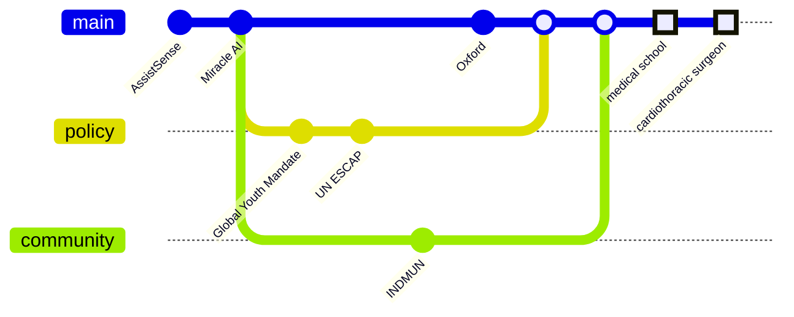

<div align="center">




</div>

---

## 👋 Hi, I'm Prakhar (everyone calls me "Bantu")

> *Empathy + engineering = a more human world.*

| | |
|:--|:--|
| 🫁 **Building** | Medical AI that assists doctors, never replaces them |
| 🏛️ **Founded** | Global Youth Mandate, because young people belong in decision rooms |
| 🌐 **Spoke at** | UN ESCAP (3 interventions, 1 tall microphone) |
| 🎓 **Selected for** | John Locke Institute Signature Course, Oxford |
| 🪑 **Chaired** | 28+ Model UNs and survived all of them |
| 🎶 **Plays** | Harmonium, piano, ukulele, and a classical vocal |
| 🫀 **Becoming** | A cardiothoracic surgeon who builds the tools too |

<div align="center">




</div>

---

## 🫀 My whole personality, in 5 lines of Python

```python
while alive:
    learn()
    build()
    speak_up_for_those_without_a_seat()
    if time_for_sleep: continue   # known bug, open since 2022
```

---

## 🕹️ Pick a room

<div align="center">


</div>

<details>
<summary>🔓 <b>Secret #1: Debugging, as practised in the Lab</b></summary>

1. Stare at the error.
2. Google the error.
3. Click the Stack Overflow answer from 2014. It says "deprecated".
4. Restart the kernel. (Works 40% of the time. Every time.)
5. The bug was a typo in a variable named `final_final_v3_REAL`.
6. Commit with the message "minor fixes". Tell nobody.

</details>

<details>
<summary>🔓 <b>Secret #2: The Diplomat-to-English dictionary</b></summary>

| They say | They mean |
|:--|:--|
| *"We note with concern..."* | We are quietly furious. |
| *"With the greatest respect..."* | With none. |
| *"We take note of the proposal."* | We read it. We will do nothing. |
| *"A constructive and frank exchange."* | Somebody raised their voice. |
| *"The text is balanced."* | Everyone is equally unhappy. |
| *"Further consultations."* | Please never ask us again. |

</details>

<details>
<summary>🔓 <b>Secret #3: Why one number lies (the 99% accuracy trap)</b></summary>

A model that says *"everyone is healthy!"* on 1,000 X-rays where 10 people are sick is **99% accurate** and has helped **0 of 10** patients.

So in medicine we ask about **sensitivity** (did you catch the sick?), **specificity** (did you leave the healthy alone?) and **external validation** (does it work at a different hospital?).
A number is a *claim*. A claim needs *evidence*. 🩺

</details>

<details>
<summary>🔓 <b>Secret #4: Lucknow, in one deadlock</b></summary>

```go
// "Pehle aap!"  "No, no, pehle aap!"
func main() {
    door := make(chan string)
    go func() { <-door }()   // A waits for B to go first
    go func() { <-door }()   // B waits for A to go first
    select {}
    // fatal error: all goroutines are asleep - deadlock!
    // (tehzeeb: 100, traffic: 9)
}
```

</details>

<details>
<summary>🔓 <b>Secret #5: Doctor jokes (you were warned)</b></summary>

- *"Doctor, I keep thinking I'm a deck of cards."* → *"Sit down, I'll deal with you later."*
- *"Why did the heart go to therapy?"* → *"Too many issues with the left."*
- *An AI, a surgeon and a policymaker walk into a bar. The AI predicts the punchline, the surgeon operates on the joke, and the policymaker forms a committee to study why nobody's laughing.*

</details>

---

## 🗺️ The roadmap (as a git graph)



---

## 🚨 Error codes

| Code | Meaning | Fix |
|:-:|:--|:--|
| `E001` | Slept less than 4 hours | Coffee. (Not a fix.) |
| `E404` | Time not found | Reschedule everything. |
| `E418` | Asked to chair + code + play harmonium at once | Pick two. |
| `E999` | Said "yes" to a 5th project | Wait for it to compile. |

## ❓ Quick FAQ

**Are you a doctor?** Not yet. Ask me again in about a decade.
**Is Miracle AI ready for hospitals?** No. It's a research prototype, and doctors stay in the loop.
**Do you sleep?** `sleep.ko not found.` See boot log.

---

<div align="center">


### 💬 Want to build something? Medical AI · Youth Policy · Research · Internships

[](https://www.linkedin.com/in/prakharbiswas/)
[](https://github.com/prakharbiswas)

```text
सहानुभूति + इंजीनियरिंग = एक बेहतर इंसानी दुनिया
```

</div>
